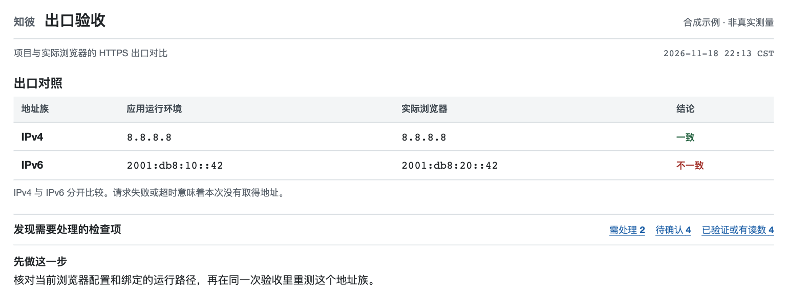

# 知彼（claude-zhibi）

> **知己知彼，从风控的视角降低 Claude 账号的封禁风险。**

**知彼**是一套面向 Claude 长期稳定使用的全流程 Agent Skill。从账号开通引导、本地与出口网络实测，到独立浏览器配置、隔离 Linux 编码环境搭建，你只需要把任务交给 Agent，它会一步步陪你完成配置与验收；使用过程中遇到任何问题，也可以直接向安装本仓库的 Agent 提问。

*btw，作者本人已通过这套方案长期稳定使用两个 $200/月的 Claude Ultra Plan 账号:)*

[核心理念](#为什么叫知彼) · [整体架构](#整体架构一览) · [体检报告](#核心体验看得见的出口一致性) · [快速开始](#快速开始) · [准备与边界](#准备清单与使用边界) · [日常使用](#日常使用) · [底层与隐私](#底层实现与隐私安全) · [English](README.en.md)

---

## 为什么叫「知彼」？

市面上不少防封方案，一上来就建议在本机套一层重型虚拟机。对大多数开发者来说，这不仅吃内存、耗电、割裂编码体验，而且一旦宿主机代理闪断，依然可能漏出真实网络特征。更关键的是，如果不清楚平台风控到底在关注什么，哪怕套上虚拟机也一样可能踩坑。

我们追求的是**轻量、可控、可复查的长期稳定**。「知彼」的设计从两个方向出发：

### 1. 知彼：大厂风控在关注什么？

现代风控系统很少只看“IP 在不在海外”，而是对**多维信号的自洽性**做交叉验证：

- **网络层**：出口 IP 的纯净度与 ASN 属性（住宅段还是机房段）、历史复用风险，以及底层协议是否漏出真实地址（WebRTC、DNS、直连 UDP、IPv6）。
- **终端层**：客户端上报的宿主环境特征（系统时区、语言、硬件与系统级遥测、应用商店与支付归属地）。
- **轨迹层**：同一账号在不同终端、不同时段登录时，网络出口与设备画像是否前后冲突。

### 2. 知己：主动收敛暴露面，而不是硬抗伪装

与其费力去伪装一台充满日常痕迹的主力电脑，不如**主动收敛使用入口**。客户端越“原生”，获取的系统底层权限就越深，在主力设备上也就越难包裹得滴水不漏（比如手机上的 SIM 卡、App Store 归属与定位，或桌面客户端读取的宿主机环境与真实网卡）。

因此，「知彼」选择砍掉高风险的原生客户端，把日常使用收敛进两个**暴露面极小、边界清晰**的环境里，同时保留你对具体工具的选择权：

1. **网页对话 → 独立浏览器**
   将日常对话隔离在独立的浏览器沙盒中，收敛指纹、Cookie、WebRTC 与时区语言。你可以由知彼配置专用 Chromium，也可以沿用习惯的指纹浏览器（如 AdsPower、MoreLogin、比特浏览器）。*如果只用网页版，走到这一步就够了。*
2. **写代码（Claude Code CLI）→ 隔离的 Linux 环境**
   浏览器保护不了本机终端，在宿主机命令行直接运行 CLI 很容易暴露本地环境。我们将 CLI 放进干净的 Linux 工作区，并与独立浏览器**严格对齐到同一海外出口与区域特征**：
   - **首选推荐 · 远程 Linux 服务器**：可直接复用你的海外 VPS（一机两用），本机零资源负担，且天然位于海外网络，从根源上避免跨境代理闪断导致的裸连泄漏。
   - **兼容备选 · 本机 Linux 虚拟机**：如果项目代码因合规或保密要求不便上云，知彼也支持部署在本机虚拟机中；它对本机硬件和防泄漏配置要求更高，建议按需选用。

> *说明：以上风控模型整理自作者在 ByteDance 从事国际风控 Agent 研究期间的实践总结，难免有个人视角局限，也不代表 Anthropic 官方规则，欢迎在 Issue 中一起交流探讨。*

---

## 整体架构一览

```text
┌──────────────────────── 你的日常主力电脑 (本地宿主机) ───────────────────────┐
│                                                                              │
│  ✅ 独立浏览器                           ✅ 本地编辑器 / 终端                │
│     (负责：日常网页对话)                    (负责：Remote-SSH / 纯 SSH)      │
│     * 专用 Chromium 或自选指纹浏览器        * 连入远端服务器或本机虚拟机     │
│                                                                              │
│  ❌ 不在日常浏览器直接登录               ❌ 不在宿主机终端直接运行 CLI       │
│  ❌ 长期使用不安装桌面端与手机 App（Google Play 订阅期除外，见下文边界）     │
└───────────────┬──────────────────────────────────────────┬───────────────────┘
                │ 独立代理通道                              │ SSH 开发连接
                ▼                                          ▼
┌──────────────────────────────────────────────────────────────────────────────┐
│  海外 VPS (独享网络底座)            +            隔离的 Linux 环境 (CLI 底座)│
│                                                                              │
│  首选：远程 Linux 服务器 —— 与左侧 VPS 一机两用（建议内存 ≥ 2 GB）           │
│  备选：本机 Linux 虚拟机 —— 代码留在本地，对资源与防泄漏配置要求更高         │
└───────────────────────────────────────┬──────────────────────────────────────┘
                                        │ 统一出口（VPS 原生 IP 或静态住宅代理）
                                        ▼
                           唯一、固定、纯净的海外出口 IP
                        （IPv4 / IPv6 / DNS / 时区 / 语言对齐）
                                        │
                                        ▼
                              Anthropic (Claude 服务)
```

---

## 核心体验：看得见的出口一致性

**网页和 Claude Code 走的真是同一条线路吗？** 很多时候问题不在“连不上”，而在不易察觉的协议分叉。

知彼在交付前会自动生成一份可复查的体检报告：只用网页版时，对比浏览器与代理出口；同时使用 Claude Code 时，并排核对浏览器与 Linux 工作区的实际出口。



*报告示例：IPv4 一行两端完全一致，但 IPv6 却指向了不同地址。如果只查 IPv4，这处风险就会被漏掉。*

拿到报告后，先核对两端出口地址，再逐项处理标为「需处理」或「待确认」的条目，每项都会附带具体的下一步建议：

- **WebRTC**：核对网页实时通信暴露的公网地址，确认它与常规请求出口一致。
- **DNS**：配置观测端后，查看实际处理域名查询的解析器归属。
- **换线复查**：保留交付记录，后续更换线路或重启服务后可随时对照复检。详见[出口一致性与断线演练](skills/zhibi/references/audit.md#出口一致性)。

---

## 快速开始

### 第一步：让 Agent 安装知彼

打开 Codex（或其他支持本地命令与桌面交互的 Agent），把下面这句话发给它：

```text
帮我在电脑上安装知彼（https://github.com/yinwu01/claude-zhibi），装好后告诉我怎么开始。
```

### 第二步：启动引导

安装完成后，**新开一个 Codex 对话**，输入：

```text
$zhibi 带我开始，从我当前的进度继续。
```

Agent 会了解你的使用需求、账号准备进度以及是否已有 VPS，然后带你逐步推进。你也可以直接说明当前情况，例如「我已经付费，只想配网页版」或「还没有服务器，先帮我检查这台电脑」。

如果 Agent 具备桌面操作能力，它可以对着你眼前的页面做实时引导；涉及密码、验证码与最终付款的步骤，始终由你本人在官方页面确认。

<details>
<summary>在终端手动安装或升级</summary>

确认本机已安装 Git、Python 3.9+ 和 Codex，然后在终端运行：

```bash
git clone https://github.com/yinwu01/claude-zhibi.git
cd claude-zhibi
python3 scripts/install_skill.py --host codex
```

看到「已安装完整知彼 Skill」后，新开 Codex 对话并输入 `$zhibi` 即可。

升级已有安装时，在最新代码目录下再次执行最后一条命令，并在末尾加上 `--replace`。安装器会自动备份旧版并打印回退命令。

</details>

### 两条典型配置路线

#### 路线 A：只用 Claude 网页版

对 Agent 说：「帮我把网页版配好，接入我的 VPS，告诉我以后打开哪个浏览器。」

知彼可以为你创建专用 Chromium，也可以接管你已有的指纹浏览器配置。Agent 会实测浏览器出口并交付固定的启动方式。在 macOS 或使用 systemd 的 Linux 上，还可以顺手配好后台连接服务：即使隧道短暂中断，专用 Chromium 也会保持走指定代理，并由后台自动尝试重连。[连接与维护](skills/zhibi/references/runtime.md)

#### 路线 B：网页版 + Claude Code

对 Agent 说：「我还要写代码。帮我把网页版和 Claude Code 配到同一出口，并给我一个项目启动入口。」

- **已有 Linux VPS 或开发服务器（推荐）**：直接复用现有服务器，一台机器同时承担网络出口和工作区。你在本机用 VS Code 或 Cursor 通过 SSH 编辑远端代码，从交付的入口启动 Claude Code。[首次连接服务器](skills/zhibi/references/remote.md#首次连接)
- **暂无服务器，或希望代码留在本地**：在 Apple 芯片 Mac 或 amd64 Linux 上，知彼可借助 [PVM](https://github.com/huangzheng2016/pvm) 创建本地 Ubuntu 虚拟机，也可通过 SSH 接入你已有的虚拟机。项目目录在宿主机与虚拟机间共享，本地编辑、虚拟机运行。[本地虚拟机方案](skills/zhibi/references/local-vm.md)

> **小提示：虚拟机决定代码在哪里跑，出口决定流量从哪里出去。** 默认情况下本机虚拟机沿用电脑网络；如果需要网页与代码共用固定远端出口，再接入你自己的 VPS。

---

## 准备清单与使用边界

### 需要准备什么

| 准备项 | 说明 |
| --- | --- |
| **自有 VPS（需要专用远端出口时）** | 机房或住宅线路均可先实测，优先选择独享且可自主管理的服务器。准备好服务器地址、SSH 用户名与端口（或已有 SSH 别名），以及服务商控制台可核对的主机指纹。 |
| **独立浏览器** | 用于 Claude 网页版。可由知彼自动配置专用 Chromium，或使用自选指纹浏览器。 |
| **Linux 工作区** | 仅使用 Claude Code 时需要。优先复用自有 Linux VPS，也支持通过 PVM 创建本地虚拟机或 SSH 接入已有 Linux 虚拟机。 |
| **Agent 与本机基础工具** | Python 3.9+、Git、SSH 客户端，以及可执行本地命令的 Agent（推荐 Codex，支持界面引导与操作辅助）。 |

如果目前只是想测一下网络，或者先开通账号，直接从现有电脑开始即可。需要通过安卓手机开通订阅的同学，可参考 [Google Play 开通教程](docs/tutorials/claude-google-play.md)（注：通过 Google Play 订阅会产生平台渠道溢价，$200/月档位实际支付约 $250/月）。

### 完成后你会得到什么

- **账号开通引导**：按你的实际条件协助完成注册与订阅流程，全程随时可问 Agent。
- **开箱即用的独立浏览器**：配好出口与基础环境，日常直接打开使用。
- **隔离的 CLI 工作区**（选配 Claude Code 时）：隔离的 Linux 运行环境与绑定到具体项目的启动入口。
- **可复查的验收记录**：包含双端 IPv4 / IPv6、WebRTC 与 DNS 核对结果，方便日后对照复检。

### 使用边界（哪些支持，哪些不建议）

把日常入口收敛在**独立浏览器**与**隔离 Linux** 两处，能尽量减少同一账号下设备特征与联网方式的混杂，也方便 Agent 做一致的实测验证。

| 场景 | 推荐用法（知彼覆盖配置与验收） | 不推荐用法（不在验收范围内） |
| --- | --- | --- |
| 网页对话 | 打开知彼交付的专用 Chromium 或配置好的指纹浏览器。 | 在日常主力浏览器默认配置中直接登录；长期安装并使用 Claude Desktop 或手机 App。 |
| 编码开发 | 本机编辑器远程连接，通过交付入口在远程或隔离 Linux 中运行 Claude Code。 | 在主力电脑终端或未经配置的 SSH 环境里直接启动 CLI。 |

> **关于 Google Play 订阅的临时例外**：若通过 Google Play 注册或开通订阅，需要临时安装安卓版 Claude App 完成登录与付款。待网页端确认套餐生效后，请及时卸载手机 App，之后日常回到独立浏览器与隔离 Linux 使用。

---

## 日常使用

配置完成后，请先打开交付目录中的 **`先读我.md`**，里面记录了本次为你配好的浏览器名称、项目路径与具体命令：

- **聊 Claude**：打开交付说明中指定的浏览器配置。专用 Chromium 可运行 `open-browser.sh`；若浏览器装在 PVM 桌面内，则运行 `open-vm-desktop.sh`。
- **写代码**：在本机终端进入交付目录，执行 `bash open-project.sh` 启动绑定项目，并用本机编辑器通过 SSH 打开代码。若交付说明已确认远端项目中的 `claude` 指向隔离入口，也可以直接在远端项目里输入 `claude`。[编辑器接入](skills/zhibi/references/projects.md#编辑器接入)
- **换线或排障后复查**：把交付目录交给 Agent，说一句「帮我复查现在的出口」。若涉及浏览器，先从当前浏览器重新采集一次，再由 Agent 运行 `reproduce.sh` 与初始交付记录逐项比对。[交付与复查](skills/zhibi/references/deliver.md)

---

## 底层实现与隐私安全

- **进程与目录隔离**：在远程 Linux 上使用 [`bubblewrap`](https://github.com/containers/bubblewrap) 隔离进程与主目录，收敛 CLI 可见环境。
- **强制代理接管与断线演练**：使用 [`graftcp`](https://github.com/hmgle/graftcp) 将应用及其子进程的 TCP 连接交由指定代理，浏览器使用独立网络配置；Agent 支持通过受控断线演练验证阻断与恢复机制，并将结果与仍需人工核验的协议写入本地报告。
- **凭证与隐私边界**：账号登录、密码、验证码与支付确认全部由你本人在官方页面亲自完成，不经手任何第三方中转。
- **合规与免责说明**：请遵守 Anthropic 服务条款及[支持地区政策](https://www.anthropic.com/legal/supported-regions)。知彼的体检报告仅反映当前可观测的本地与网络信号是否自洽，不代表官方风控结论，也无法对账号安全做出绝对保证。

延伸阅读：[双路线架构](docs/implementation/two-route-plan.md) · [持久化入口](docs/implementation/native-delivery.md) · [数据流与隐私](docs/reference/privacy.md)

---

## 致谢与参考项目

感谢以下优秀开源项目的作者与贡献者：

- [xiaoxiaodong-vps](https://github.com/nevertoday/xiaoxiaodong-vps)：VPS 部署、Agent Skill 组织与运维流程参考。
- [CCBaga](https://github.com/liseami/CCBaga)：网络检查与环境配置流程参考，适配了部分浏览器出口检测代码。
- [CheckCC](https://github.com/yacuo/check-cc)：适配了部分浏览器环境采集、字体探测与研究模型。
- [IPQuality](https://github.com/xykt/IPQuality)：IP 质量检测方法研究与对照。
- [Blackhole](https://github.com/tommy0103/blackhole)：项目绑定、持久化会话与启动体验参考。
- [PVM](https://github.com/huangzheng2016/pvm)：提供本地 Linux 虚拟机、共享目录、桌面与出口能力的可选后端。
- [bubblewrap](https://github.com/containers/bubblewrap)：Linux 轻量级进程沙箱隔离工具。
- [graftcp](https://github.com/hmgle/graftcp)：应用及其子进程的代理网络接管工具。

[MIT](LICENSE) · [第三方声明](THIRD_PARTY_NOTICES.md) · [上游复用说明](docs/research/upstream-reuse.md) · [贡献指南](CONTRIBUTING.md)
