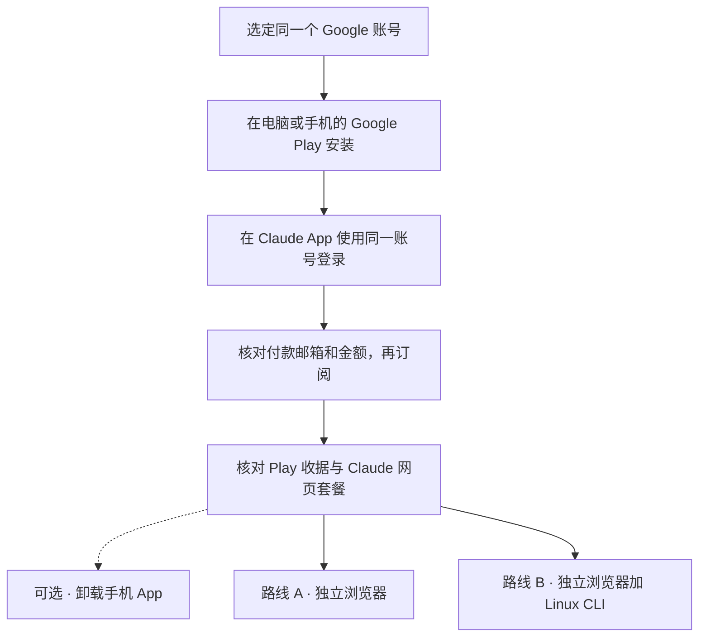

# 通过 Google Play 开通 Claude 订阅

这条路线从头到尾使用**同一个 Google 账号**。在电脑和手机的 Google Play 中用它安装和付款，在 Claude App 和网页中选「使用 Google 登录」，也用这个账号。手机用于开通并检查订阅。确认网页端的套餐到账后，可以卸载手机 App，再用知彼配置好的环境日常使用。

想让 Agent 跟着你操作，可以先按 [快速开始](../../README.md#快速开始) 安装知彼，再告诉它：

> $zhibi 带我用 Google Play 开通 Claude。我可以告诉你账号已经准备到哪一步，请从那里接着走。

Agent 可以打开官方入口、核对页面状态和提示下一步。它看不到手机画面时，你按当前一步操作并告诉它结果。密码、验证码和付款确认由你在官方页面处理。已有账号或订阅时，可以从核对登录或套餐的步骤开始。

Google Play 负责扣款和续订，Claude 负责登录和套餐。付款后分别查两边。

## 贯穿全程的三个检查点

- **账号核对同一个邮箱。** 在 Play 商店、Claude 登录、付款弹窗和网页套餐页都有机会核对。尤其是手机上已有多个 Google 账号时，以实际支付窗口显示的邮箱为准。
- **地区和付款填真实资料。** 建立或变更 Play 地区时，核对所在地及当地支付方式要求。使用 Claude 前也核对实际所在地是否受支持。VPS 在哪里是网络配置；服务资格和付款资料各自按平台要求核对。 [Google Play 地区规则](https://support.google.com/googleplay/answer/7431675) · [Anthropic 支持地区政策](https://www.anthropic.com/legal/supported-regions)
- **给每一步所需的权限和资料。** 用独立的浏览器配置区分账号和会话，关闭用不到的权限或扩展。验证码、卡号和账单地址只在对应官方页面填写；教程截图和排查记录用示例数据。知彼能复查具体配置和网络读数。Claude 也明确说明会用 IP 等信号推断大致位置，知彼的检测结果无法预判平台会怎样判定账号。 [知彼的数据流与隐私说明](../reference/privacy.md) · [Claude 位置数据说明](https://privacy.claude.com/en/articles/11186740-does-claude-use-my-location)

## 1. 准备手机、手机号和支付方式

- **一部有 Google Play 商店的安卓手机。** 先确认手机能打开 Play 商店。切到这次使用的 Google 账号后，再核对该设备能否安装 [Claude by Anthropic 官方应用](https://play.google.com/store/apps/details?id=com.anthropic.claude)。找不到时，可以核对设备、系统版本和地区。 [Claude Android 安装说明](https://support.claude.com/en/articles/9612887-install-claude-for-android)
- **一个你能长期管理的 Google 账号，以及在需要时能收验证码的手机号。** 需要新建账号时，前往 [Google 账号登录入口](https://accounts.google.com/) 选择「创建账号 → 供个人使用」，按提示填写资料。电脑上可以使用独立浏览器配置或无痕窗口，方便确认当前登录的是哪个账号。之后注意保存好账号的恢复方式。 [Google 账号创建说明](https://support.google.com/accounts/answer/27441)
- **一张当前 Google Play 地区接受的信用卡或其他支付方式。** 手机打开 Play 商店，点头像，切到这个 Google 账号，再进入「付款和订阅 → 付款方式」。也可以在 [Google 付款中心](https://payments.google.com/) 查看付款资料。卡组织、发卡地和地区的组合以实际要求和结账结果为准。 [Google Play 接受的付款方式](https://support.google.com/googleplay/answer/2651410) · [添加付款方式](https://support.google.com/googleplay/answer/4646404)

电脑上已有知彼配置的独立浏览器时，可以用同一个浏览器配置完成这些步骤。首次设置或更改 Google Play 地区时，按 Google 关于实际所在地和当地支付方式的要求操作。继续安装或付款前，也要核对 Claude 的服务地区要求。 [Google Play 地区说明](https://support.google.com/googleplay/answer/7431675) · [Anthropic 支持地区政策](https://www.anthropic.com/legal/supported-regions)

## 2. 用指定的 Google 账号安装 Claude

在安卓手机的系统设置里添加这一个 Google 账号。打开手机的 Play 商店，点右上角头像和账号下拉箭头，确认当前显示的是该邮箱。然后从下面任选一种方式安装。 [添加和切换 Google Play 账号](https://support.google.com/googleplay/answer/2521798)

- **电脑端远程安装。** 打开 [Claude 官方 Google Play 页面](https://play.google.com/store/apps/details?id=com.anthropic.claude)，确认右上角是同一个 Google 邮箱。点「安装（Install）」，从设备列表里选那部安卓手机，再确认。网页下发安装指令，App 安装在所选手机上。 [Google Play 远程安装说明](https://support.google.com/googleplay/answer/14274288)
- **手机端安装。** 在手机的 Play 商店确认头像所示邮箱，再搜索 **Claude by Anthropic**，核对发布者是 **Anthropic PBC** 后点「安装」。 [Claude Android 安装说明](https://support.claude.com/en/articles/9612887-install-claude-for-android)

如果电脑上看不到那部手机，先在手机 Play 商店切到指定 Google 账号并打开商店。仍无法关联时，按 Google 的设备关联说明在手机上完成一次安装，再刷新网页。 [设备关联排查](https://support.google.com/googleplay/answer/6178908)

## 3. 在 Claude App 登录和开通订阅

1. 打开手机上的 Claude，选「使用 Google 登录（Continue with Google）」。Google 选账号时，再核对一次邮箱。需要开通新 Claude 账号时，按页面完成该账号的注册和验证。 [Claude 登录说明](https://support.claude.com/en/articles/13189465-log-in-to-your-claude-account)
2. 点 Claude App 的头像，进入设置或升级入口，选择界面实际提供的套餐。付款前展开 Google Play 的支付窗口，核对 **Google 邮箱、卡片尾号、套餐、首期金额和续费周期**。如果 Claude 显示的是另一个登录邮箱，或付款窗口显示旧 Google 账号，先退出，核对两个页面再继续。Google 的 Billing 文档说明了多账号设备上的下载账号与付款账号关系。付款窗口显示的账号是这笔交易的最后确认。 [Claude Android 订阅说明](https://support.claude.com/en/articles/9612892-how-do-i-sign-up-for-claude-pro-on-claude-for-android) · [Google Play Billing 多账号说明](https://developer.android.com/google/play/billing/test)
3. 付款后，用同一个 Google 账号查看 [Google Play 订阅](https://play.google.com/store/account/subscriptions) 或 [订单记录](https://play.google.com/store/account/orderhistory)，确认出现 Claude 订阅。浏览器中打开 [Claude 网页版](https://claude.ai/)，仍选「使用 Google 登录」，确认账号和套餐都对。如果已有 Google Play 订单，但网页登录还是免费版，先检查两边显示的邮箱，避免重复付款。 [查看 Google Play 订单](https://support.google.com/googleplay/answer/2850369) · [Claude 账单排查](https://support.claude.com/en/articles/8325618-paid-plan-billing-faqs)

### 美国区的价格与税费

作者记录过一次成功订单，当时用的是美国 Google Play，填写的州为加州。那次使用的 VPS 也在加州。这是单笔订单的环境记录。该笔订单的套餐小计、税额和总额待根据收据补充。

Google Play 地区影响可见的内容和支付方式。美国区若有应缴的销售税，适用规则取决于交易类型和相关州法。Google 对由它作为销售方的应税交易说明，税额按客户的合法地址计算。填写符合实际情况的付款资料，VPS 机房所在地不决定这笔订阅的税额。加州已公告从 **2027 年 1 月 1 日**起扩大部分数字产品的销售税和使用税适用范围。 [Google Play 购买税费说明](https://support.google.com/googleplay/answer/2850368) · [加州数字产品税务指南](https://cdtfa.ca.gov/industry/retailers-and-purchasers-of-digital-products/)

Claude Max 公布的网页价格与移动端定价可能不同。付款前分别看 **订阅小计、税额和总额**，付款后用 Google Play 收据复核。网页价与手机实付价之间的差额不能直接全算成税。已有订阅继续关联原付款资料，更改 Play 国家或地区不会自动迁移订阅。 [Claude Max 价格说明](https://support.claude.com/en/articles/11049741-what-is-the-max-plan) · [Google Play 订单记录](https://support.google.com/googleplay/answer/2850369) · [Google Play 地区变更说明](https://support.google.com/googleplay/answer/7431675)

## 4. 确认到账后卸载手机 App

两边都确认成功后，可以卸载手机上的 Claude App。Google Play 上已经开通的订阅会按其条款自动续费，卸载不影响续费。以后仍用原来的 Google 账号到 [Google Play 订阅管理](https://play.google.com/store/account/subscriptions) 查看下一次扣款日期、换卡或取消续订。 [Google Play 取消或更改订阅](https://support.google.com/googleplay/answer/7018481) · [Claude Android 卸载说明](https://support.claude.com/en/articles/9612887-install-claude-for-android)

## 5. 进入知彼的两条日常路线

- **路线 A，只用网页版。** 打开知彼配置好的独立浏览器环境，去 [Claude 网页版](https://claude.ai/)，选「使用 Google 登录」，用刚才开通订阅的账号。首次配置按 [网页版快速开始](../../README.md#路径-a只用-claude-网页版)。
- **路线 B，网页版加 Claude Code。** 网页继续用同一个浏览器环境。需要写代码时，进入知彼配置的 Linux 工作区，优先用自有 VPS 或远程 Linux 服务器，也可以接入本地 Linux 虚拟机。Claude Code 授权时选订阅账号，用同一个 Google 账号完成浏览器登录。首次配置按 [网页版加 CLI 快速开始](../../README.md#路径-b网页版加-claude-code)。 [用 Claude 订阅登录 Claude Code](https://support.claude.com/en/articles/11145838-use-claude-code-with-your-pro-max-or-ultra-plan)
