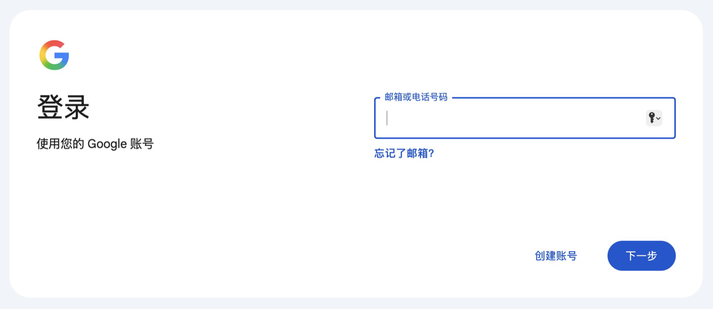
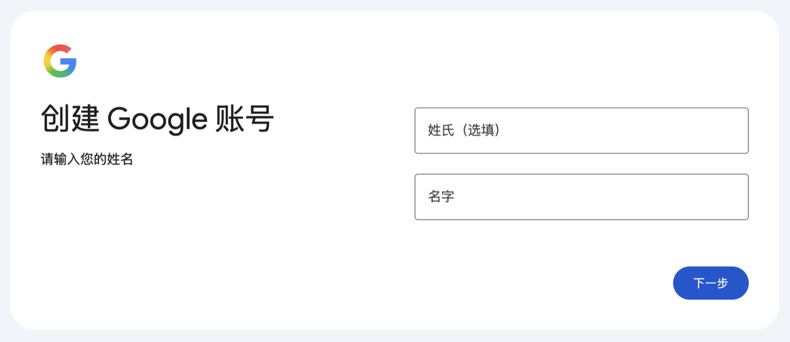
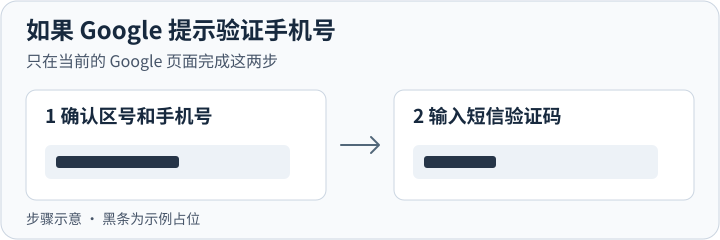
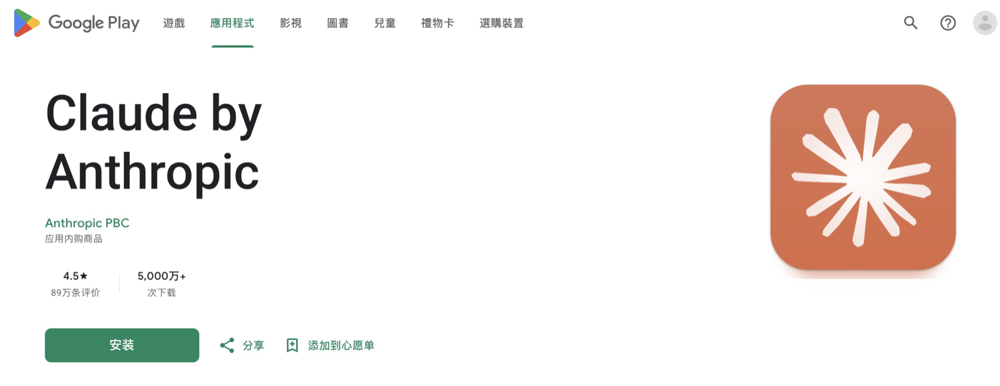
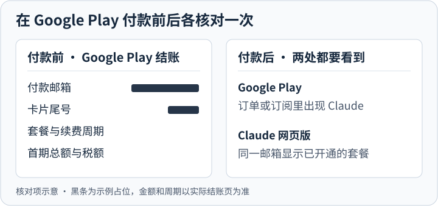

# 通过 Google Play 开通 Claude 订阅

**这一篇带你从注册 Google 账号走到确认 Claude 套餐到账。** Google Play 管扣款和续订，Claude 管登录和套餐。这条路线在电脑、安卓手机、Claude 登录页和 Play 付款窗口都选同一个 Google 邮箱。

| 你做到哪儿了？ | 从这里继续 |
| --- | --- |
| 还没有 Google 账号 | [准备手机、账号和支付方式](#1-准备-google-账号手机和支付方式) |
| 已有 Google 账号 | [在安卓手机安装 Claude](#2-用指定的-google-账号安装-claude) |
| 手机已经装好 Claude | [登录并开通订阅](#3-在-claude-app-登录和开通订阅) |
| 已扣款，想知道套餐到了没有 | [直接核对订单与套餐](#核对订单与套餐) |
| 网页已经显示付费套餐 | [进入日常使用](#5-进入知彼的两条日常路线) |

想让 Agent 跟着你操作，可以先按 [快速开始](../../README.md#快速开始) 安装知彼，再告诉它：

> $zhibi 带我用 Google Play 开通 Claude。我可以告诉你账号已经准备到哪一步，请从那里接着走。

Agent 可以打开官方入口、核对页面状态和提示下一步。它看不到手机画面时，你按当前一步操作并告诉它结果。密码、验证码和付款确认由你在官方页面处理。已有账号或订阅时，可以从核对登录或套餐的步骤开始。

### 开通流程一览

1. **[选定同一个 Google 账号](#1-准备-google-账号手机和支付方式)。** 安装、登录和付款都用这个邮箱。
2. **[安装安卓 Claude App](#2-用指定的-google-账号安装-claude)。** 在电脑上的 Google Play 选择目标手机，或直接在手机的 Play 商店安装。
3. **[登录并订阅](#3-在-claude-app-登录和开通订阅)。** 在 Claude App 用同一个 Google 账号登录，核对付款邮箱和金额后再订阅。
4. **[确认到账](#核对订单与套餐)。** 核对 Google Play 收据和 Claude 网页端显示的套餐。
5. **[卸载手机 App](#4-确认到账后卸载手机-app)，进入日常使用。** 选[路线 A · 独立浏览器](../../README.md#路线-a只用-claude-网页版)，或[路线 B · 独立浏览器加 Linux CLI](../../README.md#路线-b网页版--claude-code)。

## 贯穿全程的三个检查点

- **账号核对同一个邮箱。** 在 Play 商店、Claude 登录、付款弹窗和网页套餐页都有机会核对。尤其是手机上已有多个 Google 账号时，以实际支付窗口显示的邮箱为准。
- **地区和付款填真实资料。** 建立或变更 Play 地区时，核对所在地及当地支付方式要求。使用 Claude 前也核对实际所在地是否受支持。VPS 在哪里是网络配置；服务资格和付款资料各自按平台要求核对。 [Google Play 地区规则](https://support.google.com/googleplay/answer/7431675) · [Anthropic 支持地区政策](https://www.anthropic.com/legal/supported-regions)
- **给每一步所需的权限和资料。** 用独立的浏览器配置区分账号和会话，关闭用不到的权限或扩展。验证码、卡号和账单地址只在对应官方页面填写；教程截图和排查记录用示例数据。知彼能复查具体配置和网络读数。Claude 也明确说明会用 IP 等信号推断大致位置，知彼的检测结果无法预判平台会怎样判定账号。 [知彼的数据流与隐私说明](../reference/privacy.md) · [Claude 位置数据说明](https://privacy.claude.com/en/articles/11186740-does-claude-use-my-location)

## 1. 准备 Google 账号、手机和支付方式

- **一部有 Google Play 商店的安卓手机。** 先确认手机能打开 Play 商店。切到这次使用的 Google 账号后，再核对该设备能否安装 [Claude by Anthropic 官方应用](https://play.google.com/store/apps/details?id=com.anthropic.claude)。找不到时，可以核对设备、系统版本和地区。 [Claude Android 安装说明](https://support.claude.com/en/articles/9612887-install-claude-for-android)
- **一个你能长期管理的 Google 账号，以及在需要时能收验证码的手机号。** 已有账号可直接用。打开 [Google 账号](https://myaccount.google.com/)，核对当前浏览器中的邮箱。如果同一浏览器里登录了多个账号，点击页面的头像切换到这次要用的账号。
- **一张当前 Google Play 地区接受的信用卡或其他支付方式。** 打开 [Google Play 付款方式](https://play.google.com/store/paymentmethods)，也可以在手机 Play 商店切到该账号，再进入「付款和订阅 → 付款方式」。[Google 付款中心](https://payments.google.com/) 可查看付款资料。卡组织、发卡地和地区的组合以实际要求和结账结果为准。 [Google Play 接受的付款方式](https://support.google.com/googleplay/answer/2651410) · [添加付款方式](https://support.google.com/googleplay/answer/4646404)

电脑上已有知彼配置的独立浏览器时，可以用同一个浏览器配置完成这些步骤。首次设置或更改 Google Play 地区时，按 Google 关于实际所在地和当地支付方式的要求操作。继续安装或付款前，也要核对 Claude 的服务地区要求。 [Google Play 地区说明](https://support.google.com/googleplay/answer/7431675) · [Anthropic 支持地区政策](https://www.anthropic.com/legal/supported-regions)

### 需要新建 Google 账号时

1. 可以直接打开 [Google 个人账号注册表单](https://accounts.google.com/signup?hl=zh-CN)。如果当前在 [Google 登录页](https://accounts.google.com/?hl=zh-CN)，点击表单右下角的 **创建账号**，在菜单里选 **个人用途**。 [Google 账号创建说明](https://support.google.com/accounts/answer/27441?hl=zh-Hans)

   

2. 进入「创建 Google 账号」后，按提示填姓名和基本资料，再选择登录邮箱并设置密码。记下最后选定的邮箱，后面安装、登录和付款都用它。

   

3. 如果 Google 要求验证手机号，先核对区号和号码，再输入收到的短信验证码。注册后设置自己能长期使用的恢复方式。

   

## 2. 用指定的 Google 账号安装 Claude

在安卓手机的系统设置里添加这一个 Google 账号。打开手机的 Play 商店，点右上角头像和账号下拉箭头，确认当前显示的是该邮箱。然后从下面任选一种方式安装。 [添加和切换 Google Play 账号](https://support.google.com/googleplay/answer/2521798)

- **电脑端远程安装。** 打开 [Claude 官方 Google Play 页面](https://play.google.com/store/apps/details?id=com.anthropic.claude)，确认右上角是同一个 Google 邮箱。点「安装（Install）」，选那部安卓手机，再确认。设备名称可以在 [Google Play 设备列表](https://play.google.com/library/devices) 核对。 [Google Play 远程安装说明](https://support.google.com/googleplay/answer/14274288)
- **手机端安装。** 在手机的 Play 商店确认头像所示邮箱，再打开 [Claude 官方 Play 商店页](https://play.google.com/store/apps/details?id=com.anthropic.claude)，或搜索 **Claude by Anthropic**。核对发布者是 **Anthropic PBC** 后点「安装」。 [Claude Android 安装说明](https://support.claude.com/en/articles/9612887-install-claude-for-android)

*电脑端页面实拍。先在右上角核对账号，再点左侧绿色的「安装」。登录后可用的设备会显示在设备列表中。*

如果电脑上看不到那部手机，先在手机 Play 商店切到同一个 Google 账号并打开商店。仍无法关联时，按 [Google Play 设备关联说明](https://support.google.com/googleplay/answer/6178908) 在手机上完成一次安装，再刷新网页。

## 3. 在 Claude App 登录和开通订阅

1. 打开手机上的 Claude，选「使用 Google 登录（Continue with Google）」。Google 选账号时，再核对一次邮箱。需要开通新 Claude 账号时，按页面完成该账号的注册和验证。 [Claude 登录说明](https://support.claude.com/en/articles/13189465-log-in-to-your-claude-account)
2. 点 Claude App 的头像，进入设置或升级入口，选择界面实际提供的套餐。付款前展开 Google Play 的支付窗口，核对 **Google 邮箱、卡片尾号、套餐、首期金额和续费周期**。如果 Claude 显示的是另一个登录邮箱，或付款窗口显示旧 Google 账号，先退出，核对两个页面再继续。Google 的 Billing 文档说明了多账号设备上的下载账号与付款账号关系。付款窗口显示的账号是这笔交易的最后确认。 [Claude Android 订阅说明](https://support.claude.com/en/articles/9612892-how-do-i-sign-up-for-claude-pro-on-claude-for-android) · [Google Play Billing 多账号说明](https://developer.android.com/google/play/billing/test)

### 核对订单与套餐

| 去哪里看 | 到账时能看到什么 |
| --- | --- |
| **Google Play** · 打开[订阅管理](https://play.google.com/store/account/subscriptions)，或查[订单记录](https://play.google.com/store/account/orderhistory)。 | 付款用的 Google 账号下有 Claude 订阅或对应订单；在订阅详情里可以查续费日期。 |
| **Claude 网页版** · 在[登录页](https://claude.ai/login)选「使用 Google 登录」，再进[设置 → 账单](https://claude.ai/settings/billing)。 | 同一个邮箱下显示刚购买的套餐。两边都对上，就可以回到日常使用。 |

**Play 已有订单，Claude 仍显示免费？** 先保留这笔订单，核对付款邮箱和 Claude 登录邮箱。如果邮箱相同，检查订单状态，并按官方账单帮助排查，先别重复付款。[查看 Play 订单](https://support.google.com/googleplay/answer/2850369) · [Claude 账单帮助](https://support.claude.com/en/articles/8325618-paid-plan-billing-faqs)

*付款和到账核对示意，黑条为示例占位。套餐、金额及续费周期以你的实际付款页为准。*

美国区订单怎么看价格和税费？

作者使用美国 Google Play 完成过订阅，当时填写的州为加州，所用 VPS 也在加州。要知道自己的订单实际收了多少，请在付款页分别看订阅小计、税额和总额，付款后用收据核对。网页和移动端的套餐价格可能有差异；税额按这笔交易适用的规则和实际付款资料计算。[Google Play 税费说明](https://support.google.com/googleplay/answer/2850368) · [Claude Max 定价](https://support.claude.com/en/articles/11049741-what-is-the-max-plan) · [Claude Ultra 定价](https://support.claude.com/en/articles/17728952-what-is-the-ultra-plan)

## 4. 确认到账后卸载手机 App

两边都确认成功后，卸载手机上的 Claude App，再切换到配好的日常入口。Google Play 上已经开通的订阅会按其条款自动续费，卸载不影响续费。以后仍用原来的 Google 账号到 [Google Play 订阅管理](https://play.google.com/store/account/subscriptions) 查看下一次扣款日期、换卡或取消续订。 [Google Play 取消或更改订阅](https://support.google.com/googleplay/answer/7018481) · [Claude Android 卸载说明](https://support.claude.com/en/articles/9612887-install-claude-for-android)

## 5. 进入知彼的两条日常路线

- **路线 A，只用网页版。** 打开知彼配置好的独立浏览器环境，去 [Claude 网页版](https://claude.ai/)，选「使用 Google 登录」，用刚才开通订阅的账号。首次配置按 [网页版快速开始](../../README.md#路线-a只用-claude-网页版)。
- **路线 B，网页版加 Claude Code。** 网页继续用同一个浏览器环境。需要写代码时，进入知彼配置的 Linux 工作区，优先用自有 VPS 或远程 Linux 服务器，也可以接入本地 Linux 虚拟机。Claude Code 授权时选订阅账号，用同一个 Google 账号完成浏览器登录。首次配置按 [网页版与 Claude Code 快速开始](../../README.md#路线-b网页版--claude-code)。 [用 Claude 订阅登录 Claude Code](https://support.claude.com/en/articles/11145838-use-claude-code-with-your-pro-max-or-ultra-plan)
